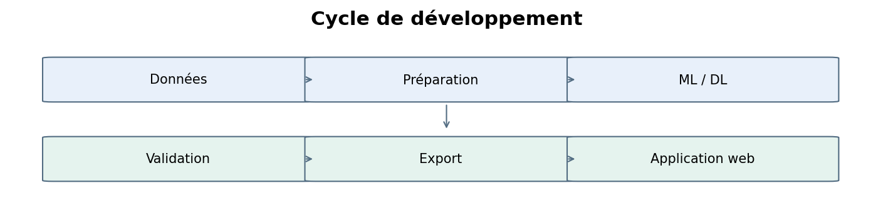
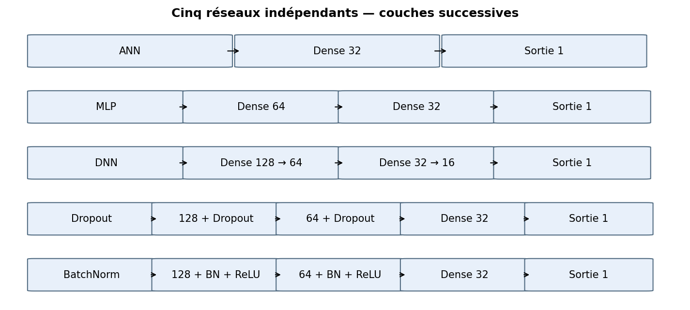
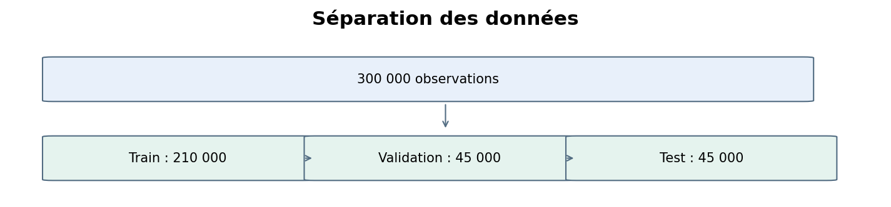
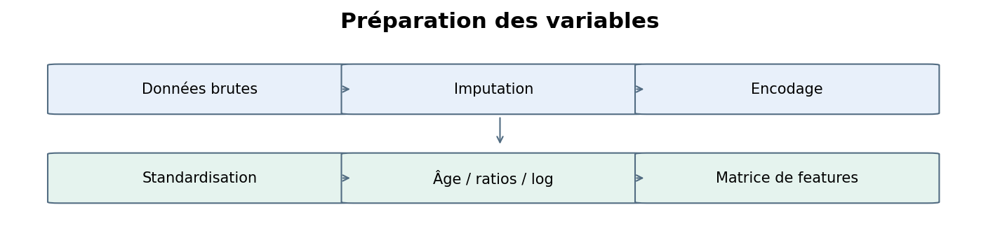
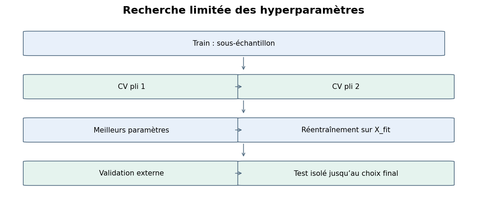
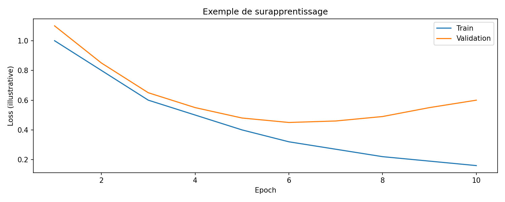
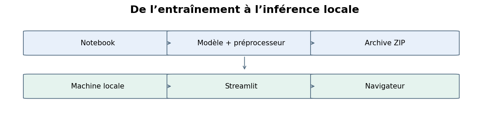

# ImmoPredict AI — TP autonome de régression et IA générative

**Durée cible : 60 minutes (mode accéléré) | Niveau intermédiaire à avancé | Google Colab + Windows + Streamlit**

## 1. Mission et règles pédagogiques
Une agence immobilière souhaite estimer le prix de vente de biens fictifs en France. Le candidat joue le rôle de Data Scientist : concevoir, générer, vérifier, corriger et déployer une solution de régression supervisée. Le prix est une valeur continue en euros. Les données sont synthétiques et ne permettent pas une estimation réelle du marché.

Le support ne fournit ni prompt complet ni solution Python. À chaque étape, rédiger son propre prompt à partir des indices, le soumettre à son IA générative, récupérer les cellules Markdown et Python, les intégrer dans le même notebook Colab, les exécuter et vérifier les résultats. Corriger les erreurs avant de poursuivre. Conserver les prompts, les réponses utiles, les corrections et les preuves d'exécution. L'IA ne doit jamais inventer de résultats.

Objectifs : CRISP-DM, qualité des données, EDA, feature engineering, régression, régularisation, bagging, boosting, cinq architectures neuronales, évaluation, XAI, sérialisation, inférence, tests et MLOps.

## 2. Prérequis et gestion du temps
- Google Colab, assistant IA générative, Python local compatible avec les versions Colab, Streamlit et dépendances préinstallées si possible.
- Préparer un notebook `TP_Regression_Immobilier.ipynb`. Garder une seule conversation IA et communiquer les noms de variables déjà utilisés. GPU facultatif pour le DL, CPU suffisant pour le mode accéléré sous réserve de ressources.
- Dataset intégral obligatoire : 300 000 lignes. Split intégral : 210 000 train, 45 000 validation, 45 000 test.
- Mode accéléré : sous-échantillon reproductible de 30 000 lignes du train et 10 000 de validation, identiques pour les dix modèles et la baseline. Test final sur les 45 000 lignes intactes. Réduire à 10 000 train et 3 000 validation si nécessaire, pour tous les modèles, en recommençant la comparaison et en documentant ce choix. Ne jamais échantillonner avant la séparation ni remplacer le dataset intégral.
- Mode complet hors séance si nécessaire : 210 000 train et 45 000 validation, mêmes dix modèles, test final indépendant. Ne pas comparer directement les scores de deux modes comme si les conditions étaient identiques. Si le test a déjà été consulté, ne pas l'utiliser pour choisir le nouveau modèle ; réserver un nouveau jeu indépendant pour une nouvelle évaluation finale.
- Limiter arbres, epochs et threads ; recherche limitée d’hyperparamètres. Une heure est un objectif, pas une garantie.

## 3. Planning
| Minutes | Phase | Livrable |
|---|---|---|
| 0–5 | Cadrage | Notebook et versions |
| 5–10 | Données | CSV 300 000 lignes |
| 10–14 | EDA | Graphiques et constats |
| 14–20 | Préparation | Splits et préprocesseurs |
| 20–30 | ML | 5 modèles + baseline et tuning |
| 30–39 | DL | 5 architectures et courbes |
| 39–44 | Évaluation | Classement et test |
| 44–49 | Industrialisation | Artefacts et inférence |
| 49–55 | Web | Streamlit et archive |
| 55–60 | Déploiement | Tests locaux |



Le notebook construit et valide le modèle ; le serveur local ne fait que charger les artefacts et prédire.

## 4. Dictionnaire des données
| Champ | Type | Description |
|---|---|---|
| id_bien | entier | Identifiant unique, exclu des features |
| ville | catégorie | Paris, Lyon, Bordeaux, Lille, Nantes, Toulouse |
| type_bien | catégorie | Maison, Appartement |
| surface_m2 | réel | Surface habitable positive |
| nombre_pieces | entier | Nombre de pièces |
| nombre_chambres | entier | Nombre de chambres |
| nombre_sdb | entier | Salles de bain |
| annee_construction | entier | Année de construction |
| distance_centre_km | réel | Distance au centre |
| distance_transport_km | réel | Distance aux transports |
| etage | entier | Étage, 0 pour maison |
| ascenseur | binaire | 0/1 |
| parking | binaire | 0/1 |
| balcon | binaire | 0/1 |
| jardin_m2 | réel | Surface du jardin |
| etat_bien | catégorie | À rénover, Bon état, Neuf |
| classe_energie | catégorie | A à G |
| prix_vente | réel | Cible en euros, positive |

300 000 lignes, 18 colonnes, 16 variables explicatives brutes. Graine 42. Environ 3 % de valeurs manquantes dans les features et 1 % d'anomalies simulées. Aucune valeur manquante dans la cible.

## 5. Modèles à développer

### Machine Learning (5)
| Modèle | Concepts | Indices de configuration rapide |
|---|---|---|
| LinearRegression | Moindres carrés, référence linéaire | Pipeline standard |
| Ridge | Régularisation L2 | alpha=1, variables standardisées |
| RandomForestRegressor | Bagging, sous-ensembles de variables | 30 arbres, profondeur 10 |
| XGBRegressor | Boosting régularisé | 50 arbres, profondeur 4, tree_method=hist |
| LGBMRegressor | Boosting par histogrammes | 50 arbres, 31 feuilles |

DummyRegressor (médiane) : baseline supplémentaire, non comptée parmi les dix candidats. Les réglages sont des points de départ, non des valeurs optimales.

### Deep Learning (5 architectures Keras Sequential)
| Architecture | Couches indicatives | Technique |
|---|---|---|
| ANN simple | Dense 32 ReLU → Dense 1 | Référence neuronale |
| MLP | Dense 64 ReLU → Dense 32 ReLU → Dense 1 | Non-linéarité |
| DNN profond | Dense 128 → 64 → 32 → 16 (ReLU) → Dense 1 | Profondeur |
| DNN Dropout | Dense 128 ReLU → Dropout 0,2 → Dense 64 ReLU → Dropout 0,2 → Dense 32 ReLU → Dense 1 | Régularisation |
| DNN BatchNorm | Dense 128 → BatchNorm → ReLU → Dense 64 → BatchNorm → ReLU → Dense 32 ReLU → Dense 1 | Normalisation des activations |



Chaque ligne représente un réseau indépendant. Les couches Dense apprennent des combinaisons des entrées ; Dropout désactive aléatoirement des activations pendant l’entraînement ; BatchNorm normalise les activations avec des statistiques apprises. La sortie unique est linéaire. Même préprocesseur dense, Adam, MSE sur cible standardisée, batch 512, 5 epochs maximum en mode rapide, EarlyStopping patience 2 avec restauration des meilleurs poids. Inverser la standardisation de la cible avant les métriques. Comparer les réseaux sur les mêmes observations.

## 6. Méthode de construction des prompts
Pour chaque étape, le candidat choisit et assemble lui-même : rôle de l'IA, contexte, objectif, entrées existantes, contraintes, bibliothèques, format de sortie, critères de validation. Les rubriques ci-dessous sont des indices, pas des prompts à copier. Demander des cellules complètes, commentées, avec Markdown en français, et préserver les contrats de données. Ne pas demander toutes les étapes en une seule fois.

### Étape 1 — Cadrage et environnement (5 min)
**Objectif :** environnement reproductible.
**Indices :** régression supervisée ; architecture CRISP-DM ; NumPy, Pandas, Matplotlib, Seaborn, sklearn, XGBoost, LightGBM, TensorFlow/Keras, Joblib, Streamlit ; graine 42 ; versions Python et packages ; GPU/CPU ; éviter les réinstallations inutiles ; chemins Colab ; dépendances Windows compatibles.
**Mode opératoire :** ouvrir Colab, créer le notebook, rédiger le prompt, intégrer les cellules d'installation/imports, exécuter, redémarrer si nécessaire.
**Validation :** imports sans erreur, versions affichées, mode rapide/complet choisi. Question : pourquoi fixer les graines ?

### Étape 2 — Génération et ingestion (5 min)
**Objectif :** 300 000 biens fictifs, 18 colonnes.
**Indices :** génération vectorisée NumPy ; dictionnaire section 4 ; prix de base par ville, surface non linéaire, état, énergie, interactions, bruit ; cohérence pièces/chambres/année/étage ; prix positifs calculés avant corruption ; 3 % de cellules explicatives manquantes et 1 % de lignes avec anomalie numérique ; ID et cible intacts ; CSV `immobilier_300000.csv` ; relecture dans `df` ; contrôles qualité.
**Mode opératoire :** rédiger le prompt, exécuter le générateur puis l'ingestion ; afficher dimensions et premières lignes ; télécharger le CSV si souhaité.
**Validation :** shape (300000,18), ID unique, cible finie et positive, taux de corruption mesurés. Question : pourquoi les prix synthétiques ne valident-ils pas le marché réel ?

### Étape 3 — EDA (4 min)
**Objectif :** comprendre distributions et qualité.
**Indices :** split reproductible 70/15/15 dès cette étape ; statistiques descriptives train ; doublons et valeurs manquantes ; histogramme prix ; boxplots ville/type/énergie ; corrélations numériques ; nuage surface/prix échantillonné ; anomalies ; pas de modification de df ; pas d'analyse du test pour choisir les transformations.
**Mode opératoire :** produire le prompt, exécuter les graphiques et relever trois constats et deux problèmes de qualité.
**Validation :** constats fondés sur sorties réelles ; corrélation distincte de causalité.

### Étape 4 — Prétraitement et Feature Engineering (6 min)



Le train sert à apprendre, la validation à choisir, le test à mesurer la généralisation finale.



Les transformations convertissent les variables brutes en entrées numériques reproductibles.
**Objectif :** données cohérentes, sans fuite.
**Indices :** X sans id_bien ni prix_vente ; y=prix_vente ; X_train/X_val/X_test et y correspondants ; 210000/45000/45000 ; sous-échantillons communs X_fit/y_fit et X_select/y_select ; imputation médiane/mode ; bornes métier fixes ou apprises uniquement sur X_fit ; âge du bien = 2026 − année ; ColumnTransformer/Pipeline ; OneHotEncoder dense, handle_unknown=ignore ; StandardScaler ; transformateur de cible DL ajusté sur y_fit ; transformations personnalisées dans un module importable et exportable, pas de lambda notebook.
**Mode opératoire :** générer les cellules, vérifier splits et échantillons, ajuster les transformations uniquement sur fit ; tester une ligne manquante et une catégorie inconnue.
**Validation :** aucun chevauchement, aucune cible dans les features, matrices finies, test intact. Question : pourquoi ajuster les transformations uniquement sur train ?

### Étape 5 — Machine Learning et optimisation (10 min)
**Objectif :** entraîner cinq modèles, transformer les variables et optimiser chaque algorithme.

**Indices pour construire vos prompts :**
- Prétraitement commun : imputation, encodage OneHot, standardisation, âge du bien ; transformations supplémentaires simples : log1p des distances non négatives, ratio pièces/surface avec protection contre zéro. Aucune variable dérivée du prix cible.
- Intégration des transformations dans un pipeline reproductible ; mêmes transformations avant et après optimisation ; ajustement dans chaque pli de validation croisée.
- Baseline DummyRegressor médiane ; cinq modèles avec paramètres initiaux ; métriques train et validation ; temps de calcul.
- Recherche limitée : GridSearchCV ou RandomizedSearchCV, KFold 2 plis mélangés avec graine 42, scoring neg_root_mean_squared_error ; 2 configurations par modèle en mode rapide, sur un sous-échantillon commun de 10 000 lignes issu de X_fit. Mode complet : 4 configurations ou davantage selon ressources.
- Réentraîner la meilleure configuration de chaque algorithme sur tout X_fit ; comparer avant/après sur X_select, jamais sur X_test. Si la configuration initiale est meilleure sur validation, la conserver et documenter ce choix.

| Algorithme | Exemples de valeurs à explorer |
|---|---|
| LinearRegression | fit_intercept True/False ; positive True/False (entrée dense) |
| Ridge | alpha 0,1 / 1 / 10 ; fit_intercept True/False |
| RandomForest | n_estimators 20/40 ; max_depth 6/10 ; min_samples_leaf 2/5 |
| XGBoost | n_estimators 30/60 ; max_depth 3/5 ; learning_rate 0,05/0,1 |
| LightGBM | n_estimators 30/60 ; num_leaves 15/31 ; learning_rate 0,05/0,1 |



La validation croisée interne choisit les paramètres à partir du train. La validation externe compare les modèles réentraînés ; le test reste isolé. La régression linéaire possède peu de réglages : les options proposées modifient les hypothèses du modèle, pas une pénalité de régularisation.

**Mode opératoire :** rédiger un prompt pour les transformations et les modèles initiaux, puis un autre pour la recherche limitée ; exécuter les cellules, afficher best_params_, scores CV, RMSE avant/après et temps. Conserver les pipelines retenus dans models_ml. Limiter les threads et éviter le parallélisme imbriqué.

**Validation :** cinq recherches réalisées, six lignes finales avec baseline, métriques finies, paramètres et gains réels documentés. Question : une optimisation améliore-t-elle toujours la validation ?

### Étape 6 — Deep Learning (9 min)
**Objectif :** développer cinq réseaux séquentiels indépendants.

**Indices :** structures section 5 ; API Sequential ; dimensions d’entrée calculées ; même matrice dense issue du prétraitement final commun ; graine par réseau ; Adam, MSE, EarlyStopping ; cible standardisée sur train uniquement puis inverse_transform ; dictionnaire models_dl ; historiques ; summary ; courbes loss/val_loss ; métriques MAE, MSE, RMSE, R² et temps ; format .keras.



Une loss de validation qui remonte alors que la loss train baisse peut signaler un surapprentissage. EarlyStopping permet de restaurer les meilleurs poids observés sur validation.

**Mode opératoire :** construire un prompt pour les utilitaires communs et un ou plusieurs prompts pour les cinq architectures ; exécuter chaque réseau et vérifier les dimensions ; ajouter les résultats au tableau comparison (model, family, mae_train, mse_train, rmse_train, r2_train, mae_val, mse_val, rmse_val, r2_val, fit_seconds). Utiliser les mêmes colonnes pour ML et DL ; préciser séparément le temps de recherche ML. Si le temps manque, signaler les modèles non terminés sans inventer de scores.

**Validation :** cinq summaries et historiques distincts, 11 lignes avec baseline si tous les modèles sont terminés. Question : quels effets ont la profondeur, Dropout et BatchNorm ?

### Étape 7 — Évaluation et XAI (5 min)
**Objectif :** sélectionner et expliquer le modèle.
**Indices :** classement des dix candidats par RMSE validation ; comparaison baseline ; écart train/validation ; MAE/RMSE en euros, MSE en euros², R² sans unité ; fonction commune de prédiction sur données brutes pour chaque famille ; inversion cible DL ; politique explicite et commune de gestion des prédictions négatives ; test final 45 000 lignes uniquement pour le modèle retenu ; réel/prédit, résidus ; permutation des features brutes sur 500 lignes validation, 2 répétitions, compatible ML et DL ; aucune optimisation après consultation du test.
**Mode opératoire :** générer et exécuter les cellules, noter le meilleur candidat, vérifier qu'il bat la baseline ; sinon signaler l'échec et utiliser la baseline comme secours documenté. Reporter les métriques réelles et limites.
**Validation :** classement complet ou incomplet explicitement signalé, métriques test du seul modèle retenu, importance par permutation. Question : pourquoi le DL n'est-il pas toujours supérieur ?

### Étape 8 — Industrialisation (5 min)



L’archive transporte le modèle et ses transformations ; aucune phase d’entraînement ne doit être nécessaire dans Streamlit.
**Objectif :** inférence indépendante du notebook.
**Indices :** dossier `immobilier_release` ; pipeline ML `model.joblib` OU réseau `model.keras` avec préprocesseur et target_scaler joblib ; ordre et types des entrées ; modules personnalisés importables ; `metadata.json` (nom, famille, architecture, mode, effectifs, versions, métriques), `schema.json` (16 features brutes, types, unités, catégories, bornes), `model_comparison.csv`, `requirements.txt` versions compatibles ; `inference.py` avec predict_price(dict), chemins relatifs à __file__, validation, chargement unique, sortie float en euros ; test de parité avant/après export avec tolérance numérique ; processus Python neuf ; artefacts de confiance uniquement.
**Mode opératoire :** rédiger le prompt, générer les fichiers depuis Colab, exécuter les tests de rechargement, inspecter les artefacts.
**Validation :** prédictions identiques à tolérance près sur plusieurs cas, sans réentraînement ; aucune dépendance à une variable du notebook.

### Étape 9 — Application web (6 min)
**Objectif :** application Streamlit locale.
**Indices :** `webapp.py` ; formulaire des 16 variables brutes issu du schéma ; contrôle bornes et catégories ; prix et prix/m² ; page performances (10 modèles + baseline, RMSE/R², gagnant, test) ; page informations (version, architecture, limites) ; `st.cache_resource` ; gestion erreurs ; AppTest avec soumission valide et invalide ; `Lancer_Application.bat` ; `MODE_OPERATOIRE.md` ; archive `immobilier_release.zip` ; téléchargement Colab ; aucun entraînement dans l'application.
**Mode opératoire :** générer les fichiers via cellules Colab, exécuter AppTest, vérifier archive et télécharger.
**Validation :** test sans exception, résultat visible, données invalides refusées, fichiers nécessaires présents.

### Étape 10 — Déploiement local (5 min)
**Objectif :** lancer le serveur et tester le navigateur.
**Indices :** Windows, PowerShell dans le dossier extrait, version Python compatible, environnement virtuel sans activation, installation requirements, Streamlit sur 127.0.0.1:8501, arrêt Ctrl+C, trois tests section 7, rollback, erreurs fréquentes.
**Mode opératoire :** construire son prompt de déploiement, vérifier les commandes proposées, extraire l'archive, ouvrir PowerShell depuis la barre d'adresse du dossier contenant webapp.py. Repères de commandes à vérifier et adapter :

```powershell
Get-Location
Get-ChildItem
python --version
python -m venv .venv
Test-Path .\.venv\Scripts\python.exe
.\.venv\Scripts\python.exe -m pip install -r requirements.txt
.\.venv\Scripts\python.exe -m streamlit run webapp.py --server.address 127.0.0.1 --server.port 8501
```

**Validation :** Test-Path True, navigateur http://localhost:8501, trois cas valides, refus d'une surface négative, arrêt/redémarrage. Si installation trop longue, noter le blocage et ne pas déclarer le déploiement réussi.

## 7. Tests fonctionnels
| Champ | A | B | C |
|---|---|---|---|
| Ville | Paris | Lyon | Lille |
| Type | Appartement | Maison | Appartement |
| Surface | 65 | 140 | 35 |
| Pièces | 3 | 6 | 2 |
| Chambres | 2 | 4 | 1 |
| SDB | 1 | 2 | 1 |
| Construction | 2010 | 2020 | 1980 |
| État | Bon état | Neuf | À rénover |
| Énergie | C | A | F |
| Distance centre | 2 | 8 | 5 |
| Distance transport | 0.3 | 1 | 0.8 |
| Étage | 3 | 0 | 1 |
| Parking | 0 | 1 | 0 |
| Balcon | 1 | 0 | 0 |
| Ascenseur | 1 | 0 | 0 |
| Jardin | 0 | 200 | 0 |
| Prix prédit | À calculer | À calculer | À calculer |

Vérifier : aucune exception, résultat fini et positif pour ces cas, prix/m² cohérent, métriques visibles, refus d'une surface négative. Modifier uniquement la surface et observer l'effet (la monotonie n'est pas garantie). Comparer la prédiction locale à celle du notebook pour le même cas.

## 8. Debugging autonome
Indices pour construire un prompt de correction : traceback complet, cellule concernée, versions, entrées et dimensions, résultat attendu, cause racine, correction minimale, cellule complète, test de non-régression. Ne pas transmettre de secrets. Réexécuter les cellules dépendantes si nécessaire et journaliser la correction.

| Erreur | Action |
|---|---|
| Activate.ps1 introuvable | Vérifier Get-Location, créer .venv dans le bon dossier ; activation facultative |
| ModuleNotFoundError | Installer via .venv\Scripts\python.exe -m pip |
| FileNotFoundError | Vérifier extraction et présence des artefacts |
| InconsistentVersionWarning | Aligner versions d'entraînement et d'inférence |
| Port occupé | Utiliser --server.port 8502 et ouvrir localhost:8502 |
| ERR_CONNECTION_REFUSED | Vérifier que Streamlit tourne et lire le terminal |
| Échec installation TensorFlow/LightGBM | Vérifier compatibilité Python, OS et roues binaires ; ne pas modifier arbitrairement les versions du modèle |

## 9. Livrables et notation
Notebook exécuté, CSV 300 000 lignes, journal des prompts, tableau comparatif, archive release et preuves de tests. Le release contient le modèle retenu et ses transformations, metadata.json, schema.json, model_comparison.csv, inference.py, webapp.py, requirements.txt, Lancer_Application.bat, MODE_OPERATOIRE.md et modules nécessaires.

| Critère | Points |
|---|---:|
| Construction autonome des prompts et vérification | 4 |
| Dataset et ingestion | 1 |
| EDA | 1 |
| Préparation sans fuite | 2 |
| Cinq modèles ML et optimisation | 2 |
| Cinq architectures DL | 4 |
| Évaluation et XAI | 2 |
| Industrialisation | 1 |
| Application web | 2 |
| Déploiement et tests | 1 |
| Total | 20 |

## 10. Checklist et débriefing
- [ ] Dataset intégral 300 000 lignes généré et contrôlé
- [ ] Splits et mode de calcul documentés
- [ ] EDA et transformations sans fuite
- [ ] Cinq ML optimisés, cinq DL et baseline comparés
- [ ] Sélection validation, test indépendant, XAI
- [ ] Export et parité d'inférence
- [ ] Application, tests et lancement local
- [ ] Journal des prompts et corrections

Questions : régression versus classification ? L2 ? Bagging versus boosting ? Pourquoi trois splits ? BatchNorm versus Dropout ? Quel effet a la profondeur ? Comment comparer les architectures ? Pourquoi inverser la cible ? Pourquoi sérialiser les transformations ? Entraînement versus inférence ? Comment vérifier le code généré ?

## 11. Maintenance et limites
Versionner données, code, dépendances et modèle ; conserver les archives précédentes pour rollback. Surveiller les distributions des entrées et les erreurs lorsque des prix réels deviennent disponibles. Réentraîner et valider avant remplacement ; ne pas déclencher automatiquement un déploiement sur une simple alerte de dérive. Le déploiement local est une démonstration, pas un service public sécurisé. Une production réelle exige données représentatives, sécurité, contrôle d'accès, supervision et validation métier.

La durée est indicative ; le mode complet peut dépasser une heure. Consigner les étapes réellement exécutées et les éventuels blocages.
