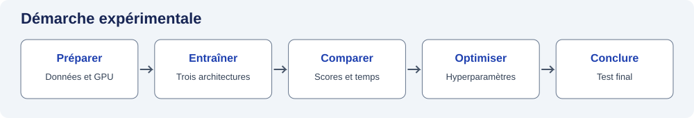
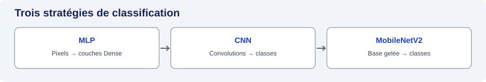

# TP — Computer Vision avec Python

**Durée maximale : 60 minutes · Niveau : débutant / intermédiaire · Environnement : Google Colab**

## Mission

Vous devez construire un système de classification d’images, comparer trois architectures de Deep Learning et améliorer un modèle en ajustant ses hyperparamètres. Utilisez un LLM de votre choix comme assistant de programmation. Vous êtes responsables de la formulation de vos demandes, de l’exécution du code et de la validation des résultats.

## Organisation de la séance

| Temps | Activité | Durée |
|---|---|---:|
| 00–05 min | Environnement | 5 min |
| 05–13 min | Données et préparation | 8 min |
| 13–19 min | Protocole et fonction commune | 6 min |
| 19–34 min | Trois architectures | 15 min |
| 34–41 min | Comparaison | 7 min |
| 41–53 min | Hyperparameter tuning | 12 min |
| 53–60 min | Test final et conclusion | 7 min |

## Comment construire vos propres prompts

Pour chaque étape, combinez les indices proposés avec votre contexte réel. Une demande efficace précise le rôle attendu, l’environnement, les variables déjà disponibles, l’objectif, les contraintes, les résultats à afficher et les vérifications nécessaires. Demandez une seule étape à la fois. Exécutez chaque cellule avant de poursuivre. Ne demandez pas un notebook complet dès le départ.

## 1. Préparer l’environnement — 5 min

Ouvrez [Google Colab](https://colab.research.google.com/), créez un notebook et activez un GPU si disponible (menu Exécution, type d’exécution).

**Indices pour votre demande au LLM :** Python, TensorFlow/Keras, NumPy, Pandas, Matplotlib, scikit-learn ; versions installées ; détection GPU avec `tf.config.list_physical_devices` ; graine aléatoire 42. Évitez les installations ou mises à jour inutiles.

**À vérifier :** les imports fonctionnent ; le matériel utilisé est identifié. Si aucun GPU n’est disponible, appliquez le mode rapide ci-dessous.

## 2. Charger et préparer CIFAR-10 — 8 min

CIFAR-10 contient 60 000 images RGB de 32 × 32 pixels réparties en dix classes : avion, automobile, oiseau, chat, cerf, chien, grenouille, cheval, bateau, camion.

Source : [site officiel CIFAR-10](https://www.cs.toronto.edu/~kriz/cifar.html).

**Travail :** charger le dataset, afficher neuf images avec leurs labels, afficher les dimensions et la distribution des classes, puis créer des sous-ensembles stratifiés reproductibles.

| Ensemble | Mode normal | Mode rapide |
|---|---:|---:|
| Entraînement | 5 000 | 1 000 |
| Validation | 1 000 | 500 |
| Test final | 1 000 | 500 |

Les ensembles d’entraînement et de validation proviennent des 50 000 images d’entraînement officielles ; le test provient exclusivement des 10 000 images de test officielles. Conservez les mêmes indices pour tous les modèles. Le reste des données n’est pas utilisé dans ce TP.

**Indices :** `keras.datasets.cifar10.load_data`, `train_test_split`, `stratify`, `random_state`, labels entiers aplatis, `imshow`, `bincount`. Conservez les pixels originaux (0–255) et intégrez le prétraitement approprié à chaque modèle. N’utilisez pas le test pour sélectionner un modèle.

**À vérifier :** dimensions, dix classes représentées, absence de recouvrement entraînement/validation, labels cohérents avec les images.

## 3. Définir un protocole commun — 6 min

| Réglage | Valeur |
|---|---|
| Époques | 3 (mode rapide : 2) |
| Batch size | 64 (mode rapide : 32) |
| Optimiseur | Adam |
| Learning rate | 0,001 |
| Loss | SparseCategoricalCrossentropy |
| Sortie | 10 neurones, Softmax |
| Sélection | Accuracy de validation |

Créez une fonction réutilisable pour entraîner un modèle neuf, conserver son historique et retourner un dictionnaire de résultats.

**Indices :** `model.fit`, `model.predict`, `time.perf_counter`, `model.count_params`, `accuracy_score`, `f1_score` avec `average="macro"`. Mesurez le temps autour de `fit` uniquement (validation incluse), puis mesurez la prédiction sur les mêmes 128 images de validation, avec le même batch size. Faites une prédiction de chauffe non chronométrée et trois répétitions chronométrées ; retenez la médiane. Calculez le débit (128 / durée en secondes) et le temps moyen par image (durée × 1000 / 128). Ce dernier n’est pas une latence unitaire.

**À vérifier :** le téléchargement des poids et la construction du modèle sont exclus du temps d’entraînement ; les sorties de prédiction sont effectivement calculées avant l’arrêt du chronomètre. Utilisez le même matériel pour les comparaisons.

## 4. Tester trois architectures — 15 min

Les trois modèles doivent accepter des images RGB et produire dix scores de classification. Réutilisez votre fonction commune. Affichez `model.summary()` avant chaque entraînement.

| Modèle | Indices techniques à intégrer à votre demande | Question à examiner |
|---|---|---|
| MLP | `Rescaling(1./255)`, `Flatten`, Dense 128 puis 64, ReLU, Softmax | Que devient la structure spatiale ? |
| CNN simple | `Rescaling(1./255)`, deux Conv2D (16 puis 32 filtres, 3×3), MaxPooling2D, Flatten, Dense 64, Dropout 0,25 | Quel est l’intérêt des convolutions ? |
| MobileNetV2 | `keras.applications.MobileNetV2`, `weights="imagenet"`, `include_top=False`, entrée 96×96, redimensionnement à la volée, `preprocess_input` sur pixels 0–255, base gelée, `GlobalAveragePooling2D`, Dense 10 | Quel est l’intérêt du Transfer Learning ? |

Pour MobileNetV2, utilisez la base en mode inférence (`training=False`) et n’effectuez pas de fine-tuning. Ne normalisez pas deux fois les pixels. Les modèles MLP et CNN apprennent à partir de zéro, contrairement à MobileNetV2 : cette différence doit être mentionnée dans votre analyse.

**Gestion du temps :** si MobileNetV2 ne peut pas être téléchargé ou entraîné dans le créneau, remplacez-le par un CNN à trois blocs convolutifs (16, 32, 64 filtres) entraîné à partir de zéro. Si vous devez réduire le volume de données, utilisez le mode rapide pour tous les modèles comparés. Notez toute déviation.

## 5. Comparer les résultats — 7 min

Construisez un DataFrame à partir des mesures réelles. Ne demandez pas au LLM d’inventer les résultats.

| Modèle | Accuracy val. | F1 macro val. | Entraînement (s) | Inférence (ms/image) | Paramètres |
|---|---:|---:|---:|---:|---:|
| MLP | | | | | |
| CNN | | | | | |
| MobileNetV2 / alternative | | | | | |

**Indices :** `pd.DataFrame`, `sort_values`, graphiques en barres pour accuracy et temps, courbes `accuracy` et `val_accuracy` à partir de `history.history`. Affichez les unités. Ajoutez le débit et les paramètres entraînables si possible.

**Analyse :** quel modèle est le plus précis ? Le plus rapide ? Les deux critères désignent-ils le même modèle ? Le nombre de paramètres suffit-il à expliquer les temps mesurés ? Trois époques suffisent-elles pour conclure sur l’overfitting ?

## 6. Hyperparameter tuning — 12 min

Optimisez le CNN simple en faisant varier uniquement son learning rate. Les autres réglages et les données doivent rester identiques.

| Essai | Learning rate | Accuracy val. | Temps (s) |
|---|---:|---:|---:|
| A (CNN initial) | 0,001 | | |
| B | 0,0001 | | |
| C | 0,01 | | |

**Indices :** fonction de construction paramétrable, `Adam(learning_rate=...)`, boucle sur les valeurs, nouveau modèle et nouvel optimiseur à chaque essai, même graine et mêmes époques, chronométrage, tri des scores de validation. Réutilisez le résultat A si le protocole est strictement identique. Il s’agit d’une recherche exhaustive sur une petite grille (Grid Search), sans bibliothèque supplémentaire.

Conservez les poids de la meilleure configuration. Mesurez le temps total des nouveaux essais et le gain d’accuracy en points de pourcentage par rapport au CNN initial. Si le temps le permet, testez deux valeurs de Dropout (0 et 0,5) en conservant le meilleur learning rate. Sinon, passez au test final à la minute 53.

**Analyse :** le meilleur réglage est-il aussi le plus rapide ? Pourquoi ne faut-il pas réutiliser les poids de l’essai précédent ? Pourquoi ne pas sélectionner les hyperparamètres sur le test ?

## 7. Évaluation finale et conclusion — 7 min

Sélectionnez votre modèle final exclusivement à partir des résultats de validation, puis évaluez-le sur le sous-ensemble de test réservé. Ne modifiez plus les hyperparamètres après cette évaluation.

**Indices :** prétraitement identique à l’entraînement, `model.predict`, `argmax`, `classification_report`, `confusion_matrix`, affichage de quelques erreurs avec leurs vrais labels et labels prédits. Exportez le tableau comparatif avec `to_csv`.

Rédigez une conclusion de cinq à huit lignes : modèle retenu, justification chiffrée, gain du tuning, compromis vitesse/précision, limites du petit échantillon et des quelques époques. Les résultats ne constituent pas un benchmark général des architectures.

## En cas de difficulté avec le LLM

| Problème | Éléments à inclure dans votre prochaine demande |
|---|---|
| Erreur Python | Traceback complet, cellule concernée, versions, correction minimale |
| Dimensions incompatibles | Shapes des entrées, labels et sorties ; couche concernée |
| Mémoire insuffisante | Batch size, résolution, prétraitement à la volée, mode rapide |
| Exécution lente | Matériel, temps mesuré, étape lente, budget restant |
| Résultats incohérents | Vérification des labels, normalisation, séparation des données, métriques |
| Code incompris | Explication des instructions, entrées/sorties, justification des choix |

## Livrables et auto-évaluation

- [ ] Notebook Colab exécuté avec les résultats visibles.
- [ ] Trois architectures testées (ou alternative documentée).
- [ ] Tableau comparatif et graphiques issus des mesures réelles.
- [ ] Recherche d’hyperparamètres et coût de recherche documentés.
- [ ] Évaluation finale et conclusion personnelle.
- [ ] Journal de trois demandes réellement formulées au LLM : objectif, demande initiale, correction éventuelle, résultat et ce que vous avez compris.

**Règle de fin de séance :** arrêtez les expérimentations à 60 minutes. Documentez les étapes non terminées et leurs causes plutôt que de présenter des résultats fictifs.

## Ressources techniques

- [CIFAR-10 dans Keras](https://keras.io/api/datasets/cifar10/)
- [Modèles Keras Applications](https://keras.io/api/applications/)
- [Guide Transfer Learning](https://keras.io/guides/transfer_learning/)
- [Documentation scikit-learn : métriques](https://scikit-learn.org/stable/modules/model_evaluation.html)
