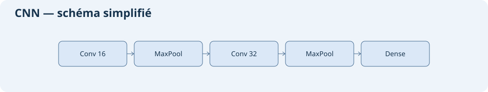
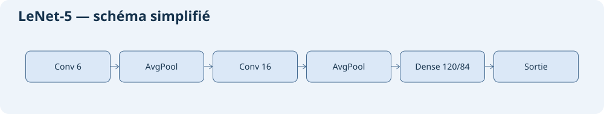
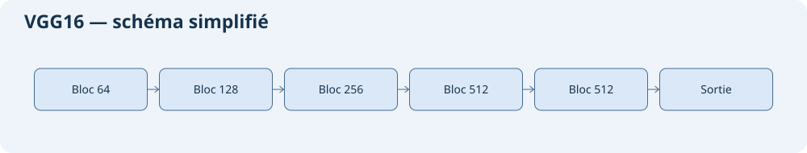
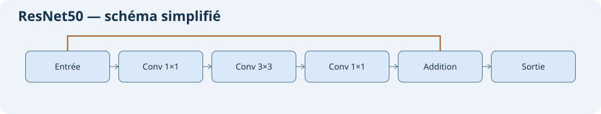
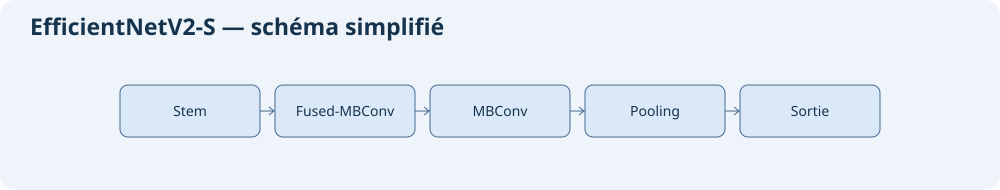
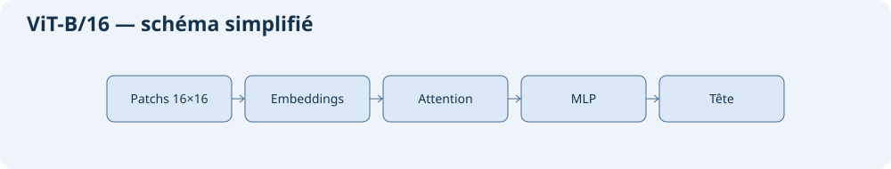
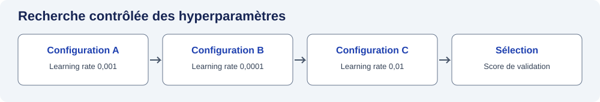

# TP — Computer Vision avec Python

**Durée maximale : 60 minutes · Niveau : débutant / intermédiaire · Environnement : Google Colab**

## Mission

Vous devez construire un système de classification d’images, comparer huit architectures de Deep Learning et améliorer un modèle en ajustant ses hyperparamètres. Utilisez Gemini comme assistant de programmation. Vous êtes responsables de la formulation de vos demandes, de l’exécution du code et de la validation des résultats.

## Organisation collective

Pour respecter les 60 minutes, travaillez en trois équipes en parallèle. L’équipe A entraîne le CNN simple et LeNet-5 sur CIFAR-10 et réalise le tuning du CNN. L’équipe B teste VGG16, ResNet50 et MobileNetV3 Small ; l’équipe C teste EfficientNetV2-S, ConvNeXt Tiny et ViT-B/16. Les équipes B et C utilisent les poids ImageNet dans un notebook PyTorch. Mutualisez les résultats pour couvrir les huit modèles. Chaque participant contribue à la génération et à la vérification du code. Si une équipe termine tôt, elle aide les autres ou reproduit une mesure. Les modèles sont des références reconnues, pas un classement actuel de l’état de l’art.

Avant la séance, si possible, vérifiez l’accès à Gemini, à Colab et aux poids préentraînés ; les téléchargements peuvent dépasser le budget prévu.

## Organisation de la séance

| Temps | Activité | Durée |
|---|---|---:|
| 00–05 min | Environnement | 5 min |
| 05–13 min | Données et préparation | 8 min |
| 13–19 min | Protocole et fonction commune | 6 min |
| 19–34 min | Huit architectures en parallèle | 15 min |
| 34–41 min | Comparaison | 7 min |
| 41–53 min | Hyperparameter tuning | 12 min |
| 53–60 min | Test final et conclusion | 7 min |

## Comment construire vos propres prompts

Pour chaque étape, combinez les indices proposés avec votre contexte réel. Une demande efficace précise le rôle attendu, l’environnement, les variables déjà disponibles, l’objectif, les contraintes, les résultats à afficher et les vérifications nécessaires. Demandez une seule étape à la fois. Exécutez chaque cellule avant de poursuivre. Ne demandez pas un notebook complet dès le départ. Vérifiez chaque cellule avant exécution, les versions, les dimensions et les sources de téléchargement. Ne transmettez pas de secrets. Demandez une correction minimale avec le traceback complet. Ne mélangez pas les frameworks dans un même modèle.

## 1. Préparer l’environnement — 5 min

**Méthode de travail :** utilisez les indices de cette étape pour rédiger votre propre prompt dans Gemini, récupérer le code Python, le lire et l’exécuter dans Colab. Si une erreur ou un bug apparaît dans le notebook, utilisez Gemini pour le diagnostiquer et le corriger : transmettez le traceback, la cellule concernée et les versions utiles, sans données sensibles. Vérifiez la correction et réexécutez la cellule avant de poursuivre.

Ouvrez [Gemini](https://gemini.google.com/) (ou son assistant intégré à Colab si disponible). Ouvrez [Google Colab](https://colab.research.google.com/), créez un notebook et activez un GPU si disponible (menu Exécution, type d’exécution).

**Indices pour construire vos prompts dans Gemini, récupérer le code et l’exécuter dans Colab en respectant les bonnes pratiques :** Python, TensorFlow/Keras, PyTorch, torchvision, NumPy, Pandas, Matplotlib, scikit-learn ; versions installées ; détection GPU avec `tf.config.list_physical_devices` ; graine aléatoire 42. Évitez les installations ou mises à jour inutiles.

**À vérifier :** les imports fonctionnent ; le matériel utilisé est identifié. Si aucun GPU n’est disponible, appliquez le mode rapide ci-dessous.

## 2. Charger et préparer CIFAR-10 — 8 min

**Méthode de travail :** utilisez les indices de cette étape pour rédiger votre propre prompt dans Gemini, récupérer le code Python, le lire et l’exécuter dans Colab. Si une erreur ou un bug apparaît dans le notebook, utilisez Gemini pour le diagnostiquer et le corriger : transmettez le traceback, la cellule concernée et les versions utiles, sans données sensibles. Vérifiez la correction et réexécutez la cellule avant de poursuivre.

CIFAR-10 contient 60 000 images RGB de 32 × 32 pixels réparties en dix classes : avion, automobile, oiseau, chat, cerf, chien, grenouille, cheval, bateau, camion.

[Consulter les exemples d’images CIFAR-10 sur le site officiel](https://www.cs.toronto.edu/~kriz/cifar.html).

Source : [site officiel CIFAR-10](https://www.cs.toronto.edu/~kriz/cifar.html).

**Travail :** charger le dataset, afficher neuf images avec leurs labels, afficher les dimensions et la distribution des classes, puis créer des sous-ensembles stratifiés reproductibles.

| Ensemble | Mode normal | Mode rapide |
|---|---:|---:|
| Entraînement | 1 000 | 1 000 |
| Validation | 1 000 | 500 |
| Test final | 1 000 | 500 |

Les ensembles d’entraînement et de validation proviennent des 50 000 images d’entraînement officielles ; le test provient exclusivement des 10 000 images de test officielles. Conservez les mêmes indices pour tous les modèles. Le reste des données n’est pas utilisé dans ce TP.

**Indices pour construire vos prompts dans Gemini, récupérer le code et l’exécuter dans Colab en respectant les bonnes pratiques :** `keras.datasets.cifar10.load_data`, `train_test_split`, `stratify`, `random_state`, labels entiers aplatis, `imshow`, `bincount`. Conservez les pixels originaux (0–255) et intégrez le prétraitement approprié à chaque modèle. N’utilisez pas le test pour sélectionner un modèle.

**À vérifier :** dimensions, dix classes représentées, absence de recouvrement entraînement/validation, labels cohérents avec les images.

## 3. Définir un protocole commun — 6 min

**Méthode de travail :** utilisez les indices de cette étape pour rédiger votre propre prompt dans Gemini, récupérer le code Python, le lire et l’exécuter dans Colab. Si une erreur ou un bug apparaît dans le notebook, utilisez Gemini pour le diagnostiquer et le corriger : transmettez le traceback, la cellule concernée et les versions utiles, sans données sensibles. Vérifiez la correction et réexécutez la cellule avant de poursuivre.

| Réglage | Valeur |
|---|---|
| Époques | 2 (mode rapide : 1) |
| Batch size | 64 (mode rapide : 32) |
| Optimiseur | Adam |
| Learning rate | 0,001 |
| Loss | SparseCategoricalCrossentropy |
| Sortie | 10 neurones, Softmax |
| Sélection | Accuracy de validation |

Créez une fonction réutilisable pour entraîner un modèle neuf, conserver son historique et retourner un dictionnaire de résultats.

**Indices pour construire vos prompts dans Gemini, récupérer le code et l’exécuter dans Colab en respectant les bonnes pratiques :** `model.fit`, `model.predict`, `time.perf_counter`, `model.count_params`, `accuracy_score`, `f1_score` avec `average="macro"`. Mesurez le temps autour de `fit` uniquement (validation incluse), puis mesurez la prédiction sur les mêmes 128 images de validation, avec le même batch size. Faites une prédiction de chauffe non chronométrée et trois répétitions chronométrées ; retenez la médiane. Calculez le débit (128 / durée en secondes) et le temps moyen par image (durée × 1000 / 128). Ce dernier n’est pas une latence unitaire.

**À vérifier :** le téléchargement des poids et la construction du modèle sont exclus du temps d’entraînement ; les sorties de prédiction sont effectivement calculées avant l’arrêt du chronomètre. Utilisez le même matériel pour les comparaisons.

## 4. Tester huit architectures — 15 min

**Méthode de travail :** utilisez les indices de cette étape pour rédiger votre propre prompt dans Gemini, récupérer le code Python, le lire et l’exécuter dans Colab. Si une erreur ou un bug apparaît dans le notebook, utilisez Gemini pour le diagnostiquer et le corriger : transmettez le traceback, la cellule concernée et les versions utiles, sans données sensibles. Vérifiez la correction et réexécutez la cellule avant de poursuivre.

Les deux premiers modèles sont entraînés sur CIFAR-10 avec le protocole commun. Les six autres utilisent les poids ImageNet officiels de `torchvision.models` sans entraînement. Utilisez les mêmes trois photos RGB libres de droits ou personnelles non sensibles, partagées entre équipes, pour tous les modèles ImageNet, choisies avant les tests. Indices communs : `get_model`, `get_model_weights`, `DEFAULT`, `weights.transforms()`, `weights.meta["categories"]`, `eval()`, `torch.inference_mode()`, `softmax`, `topk`, `sum(p.numel() ...)`. Affichez le top 3, les paramètres, la résolution et le temps de prédiction. Synchronisez CUDA avant et après chaque mesure, faites une chauffe et trois répétitions. Excluez téléchargement et prétraitement du chronométrage. Ne comparez pas les scores ImageNet aux accuracies CIFAR-10. Libérez la mémoire entre modèles. Téléchargez les poids dès le début de la séance en parallèle si possible.

### Quatre architectures classiques

#### 1. CNN

**Architecture :** Image RGB 32 × 32 → convolution 16 filtres 3 × 3, ReLU → MaxPooling 2 × 2 → convolution 32 filtres 3 × 3, ReLU → MaxPooling → Flatten → Dense 64, ReLU → Dropout 0,25 → Dense 10, Softmax.

**Mode :** Entraînement CIFAR-10, sortie 10 classes.

**Indices pour construire vos prompts dans Gemini, récupérer le code et l’exécuter dans Colab :** padding="same", model.summary(), Rescaling(1/255) ; vérifier les dimensions et le nombre de paramètres. Réutilisez le protocole commun et vérifiez les entrées, sorties et métriques.

**Correction avec Gemini :** en cas de bug, fournissez la cellule concernée, le traceback et les dimensions ; demandez une correction minimale, puis réexécutez et vérifiez les résultats.

#### 2. LeNet-5

**Architecture :** Version adaptée RGB : convolution 6 filtres 5 × 5 → AveragePooling → convolution 16 filtres 5 × 5 → AveragePooling → Flatten → Dense 120 → Dense 84 → Dense 10, Softmax. Activations tanh dans les couches cachées.

**Mode :** Entraînement CIFAR-10, sortie 10 classes.

**Indices pour construire vos prompts dans Gemini, récupérer le code et l’exécuter dans Colab :** Convolutions valid, pooling 2 × 2, normalisation identique au CNN ; expliquer les adaptations par rapport à LeNet-5 historique. Réutilisez le protocole commun et vérifiez les entrées, sorties et métriques.

**Correction avec Gemini :** en cas de bug, fournissez la cellule concernée, le traceback et les dimensions ; demandez une correction minimale, puis réexécutez et vérifiez les résultats.

#### 3. VGG16

**Architecture :** 13 convolutions 3 × 3 réparties en cinq blocs (2, 2, 3, 3, 3), MaxPooling entre blocs, puis trois couches entièrement connectées.

**Mode :** Inférence ImageNet, sortie 1 000 classes (logits).

**Indices pour construire vos prompts dans Gemini, récupérer le code et l’exécuter dans Colab :** vgg16 ; inspecter features et classifier ; expliquer le coût de la tête dense. Réutilisez le protocole commun et vérifiez les entrées, sorties et métriques.

**Correction avec Gemini :** en cas de bug, fournissez la cellule concernée, le traceback et les dimensions ; demandez une correction minimale, puis réexécutez et vérifiez les résultats.

#### 4. ResNet50

**Architecture :** Convolution initiale et pooling → quatre groupes de blocs bottleneck (3, 4, 6, 3) avec connexions résiduelles → global average pooling → classifieur.

**Mode :** Inférence ImageNet, sortie 1 000 classes (logits).

**Indices pour construire vos prompts dans Gemini, récupérer le code et l’exécuter dans Colab :** resnet50 ; inspecter layer1 à layer4 ; distinguer addition résiduelle et concaténation. Réutilisez le protocole commun et vérifiez les entrées, sorties et métriques.

**Correction avec Gemini :** en cas de bug, fournissez la cellule concernée, le traceback et les dimensions ; demandez une correction minimale, puis réexécutez et vérifiez les résultats.

### Quatre modèles modernes de référence

#### 5. MobileNetV3 Small

**Architecture :** Stem → blocs résiduels inversés avec convolutions depthwise, projections pointwise et attention Squeeze-and-Excitation selon les blocs → pooling → classifieur.

**Mode :** Inférence ImageNet, sortie 1 000 classes (logits).

**Indices pour construire vos prompts dans Gemini, récupérer le code et l’exécuter dans Colab :** mobilenet_v3_small ; hard-swish, depthwise, squeeze-and-excitation ; examiner le nombre de paramètres. Réutilisez le protocole commun et vérifiez les entrées, sorties et métriques.

**Correction avec Gemini :** en cas de bug, fournissez la cellule concernée, le traceback et les dimensions ; demandez une correction minimale, puis réexécutez et vérifiez les résultats.

#### 6. EfficientNetV2-S

**Architecture :** Stem → blocs Fused-MBConv puis MBConv → convolution finale → global average pooling → classifieur.

**Mode :** Inférence ImageNet, sortie 1 000 classes (logits).

**Indices pour construire vos prompts dans Gemini, récupérer le code et l’exécuter dans Colab :** efficientnet_v2_s ; comparer Fused-MBConv et MBConv ; relever la résolution imposée par les poids. Réutilisez le protocole commun et vérifiez les entrées, sorties et métriques.

**Correction avec Gemini :** en cas de bug, fournissez la cellule concernée, le traceback et les dimensions ; demandez une correction minimale, puis réexécutez et vérifiez les résultats.

#### 7. ConvNeXt Tiny

**Architecture :** Stem à patches → quatre stages de blocs ConvNeXt (3, 3, 9, 3) avec convolution depthwise 7 × 7, LayerNorm et projections → pooling → classifieur.

**Mode :** Inférence ImageNet, sortie 1 000 classes (logits).

**Indices pour construire vos prompts dans Gemini, récupérer le code et l’exécuter dans Colab :** convnext_tiny ; identifier les changements de résolution et les connexions résiduelles. Réutilisez le protocole commun et vérifiez les entrées, sorties et métriques.

**Correction avec Gemini :** en cas de bug, fournissez la cellule concernée, le traceback et les dimensions ; demandez une correction minimale, puis réexécutez et vérifiez les résultats.

#### 8. ViT-B/16

**Architecture :** Image → patches 16 × 16 → embeddings et positions → token de classe → 12 blocs Transformer avec attention multi-têtes et MLP → tête de classification.

**Mode :** Inférence ImageNet, sortie 1 000 classes (logits).

**Indices pour construire vos prompts dans Gemini, récupérer le code et l’exécuter dans Colab :** vit_b_16 ; vérifier la résolution des poids, le nombre de patches et la dimension des embeddings. Réutilisez le protocole commun et vérifiez les entrées, sorties et métriques.

**Correction avec Gemini :** en cas de bug, fournissez la cellule concernée, le traceback et les dimensions ; demandez une correction minimale, puis réexécutez et vérifiez les résultats.

## 5. Comparer les résultats — 7 min

**Méthode de travail :** utilisez les indices de cette étape pour rédiger votre propre prompt dans Gemini, récupérer le code Python, le lire et l’exécuter dans Colab. Si une erreur ou un bug apparaît dans le notebook, utilisez Gemini pour le diagnostiquer et le corriger : transmettez le traceback, la cellule concernée et les versions utiles, sans données sensibles. Vérifiez la correction et réexécutez la cellule avant de poursuivre.

Construisez un DataFrame à partir des mesures réelles. Ne demandez pas à Gemini d’inventer les résultats.

| Modèle | Accuracy val. | F1 macro val. | Entraînement (s) | Inférence (ms/image) | Paramètres |
|---|---:|---:|---:|---:|---:|
| CNN | | | | | |
| LeNet-5 | | | | | |

| Modèle ImageNet | Top 3 sur photo commune | Latence médiane (ms) | Paramètres | Matériel / résolution |
|---|---|---|---|---|
| VGG16 | | | | |
| ResNet50 | | | | |
| MobileNetV3 Small | | | | |
| EfficientNetV2-S | | | | |
| ConvNeXt Tiny | | | | |
| ViT-B/16 | | | | |

**Indices pour construire vos prompts dans Gemini, récupérer le code et l’exécuter dans Colab en respectant les bonnes pratiques :** `pd.DataFrame`, `sort_values`, graphiques en barres pour accuracy et temps, courbes `accuracy` et `val_accuracy` à partir de `history.history`. Affichez les unités. Ajoutez le débit et les paramètres entraînables si possible.

**Analyse :** quel modèle CIFAR-10 est le plus précis ? Le plus rapide ? Les deux critères désignent-ils le même modèle ? Le nombre de paramètres suffit-il à expliquer les temps mesurés ? Deux époques suffisent-elles pour conclure sur l’overfitting ?

## 6. Hyperparameter tuning — 12 min

**Méthode de travail :** utilisez les indices de cette étape pour rédiger votre propre prompt dans Gemini, récupérer le code Python, le lire et l’exécuter dans Colab. Si une erreur ou un bug apparaît dans le notebook, utilisez Gemini pour le diagnostiquer et le corriger : transmettez le traceback, la cellule concernée et les versions utiles, sans données sensibles. Vérifiez la correction et réexécutez la cellule avant de poursuivre.

Optimisez le CNN simple en faisant varier uniquement son learning rate. Les autres réglages et les données doivent rester identiques.

| Essai | Learning rate | Accuracy val. | Temps (s) |
|---|---:|---:|---:|
| A (CNN initial) | 0,001 | | |
| B | 0,0001 | | |
| C | 0,01 | | |

**Indices pour construire vos prompts dans Gemini, récupérer le code et l’exécuter dans Colab en respectant les bonnes pratiques :** fonction de construction paramétrable, `Adam(learning_rate=...)`, boucle sur les valeurs, nouveau modèle et nouvel optimiseur à chaque essai, même graine et mêmes époques, chronométrage, tri des scores de validation. Réutilisez le résultat A si le protocole est strictement identique. Il s’agit d’une recherche exhaustive sur une petite grille (Grid Search), sans bibliothèque supplémentaire.

Conservez les poids de la meilleure configuration. Mesurez le temps total des nouveaux essais et le gain d’accuracy en points de pourcentage par rapport au CNN initial. Si le temps le permet, testez deux valeurs de Dropout (0 et 0,5) en conservant le meilleur learning rate. Sinon, passez au test final à la minute 53.

**Analyse :** le meilleur réglage est-il aussi le plus rapide ? Pourquoi ne faut-il pas réutiliser les poids de l’essai précédent ? Pourquoi ne pas sélectionner les hyperparamètres sur le test ?

## 7. Évaluation finale et conclusion — 7 min

**Méthode de travail :** utilisez les indices de cette étape pour rédiger votre propre prompt dans Gemini, récupérer le code Python, le lire et l’exécuter dans Colab. Si une erreur ou un bug apparaît dans le notebook, utilisez Gemini pour le diagnostiquer et le corriger : transmettez le traceback, la cellule concernée et les versions utiles, sans données sensibles. Vérifiez la correction et réexécutez la cellule avant de poursuivre.

L’équipe A sélectionne son modèle CIFAR-10 final exclusivement à partir des résultats de validation, puis évaluez-le sur le sous-ensemble de test réservé. Ne modifiez plus les hyperparamètres après cette évaluation.

**Indices pour construire vos prompts dans Gemini, récupérer le code et l’exécuter dans Colab en respectant les bonnes pratiques :** prétraitement identique à l’entraînement, `model.predict`, `argmax`, `classification_report`, `confusion_matrix`, affichage de quelques erreurs avec leurs vrais labels et labels prédits. Exportez le tableau comparatif avec `to_csv`.

Rédigez une conclusion de cinq à huit lignes : modèle retenu, justification chiffrée, gain du tuning, compromis vitesse/précision, limites du petit échantillon et des quelques époques. Les résultats ne constituent pas un benchmark général des architectures.

## En cas de difficulté avec Gemini

| Problème | Éléments à inclure dans votre prochaine demande |
|---|---|
| Erreur Python | Traceback complet, cellule concernée, versions, correction minimale |
| Dimensions incompatibles | Shapes des entrées, labels et sorties ; couche concernée |
| Mémoire insuffisante | Batch size, résolution, prétraitement à la volée, mode rapide |
| Exécution lente | Matériel, temps mesuré, étape lente, budget restant |
| Résultats incohérents | Vérification des labels, normalisation, séparation des données, métriques |
| Code incompris | Explication des instructions, entrées/sorties, justification des choix |

## Livrables et auto-évaluation

- [ ] Notebook Colab exécuté avec les résultats visibles.
- [ ] Huit architectures couvertes collectivement (essais manquants documentés).
- [ ] Tableau comparatif et graphiques issus des mesures réelles.
- [ ] Recherche d’hyperparamètres et coût de recherche documentés.
- [ ] Évaluation finale et conclusion personnelle.
- [ ] Journal de trois demandes réellement formulées à Gemini : objectif, demande initiale, correction éventuelle, résultat et ce que vous avez compris.

**Règle de fin de séance :** arrêtez les expérimentations à 60 minutes. Documentez les étapes non terminées et leurs causes plutôt que de présenter des résultats fictifs.

## Ressources techniques

- [Gemini](https://gemini.google.com/)
- [Google Colab](https://colab.research.google.com/)

- [Torchvision : modèles et poids](https://pytorch.org/vision/stable/models.html)

- [CIFAR-10 dans Keras](https://keras.io/api/datasets/cifar10/)
- [Modèles Keras Applications](https://keras.io/api/applications/)
- [Guide Transfer Learning](https://keras.io/guides/transfer_learning/)
- [Documentation scikit-learn : métriques](https://scikit-learn.org/stable/modules/model_evaluation.html)
